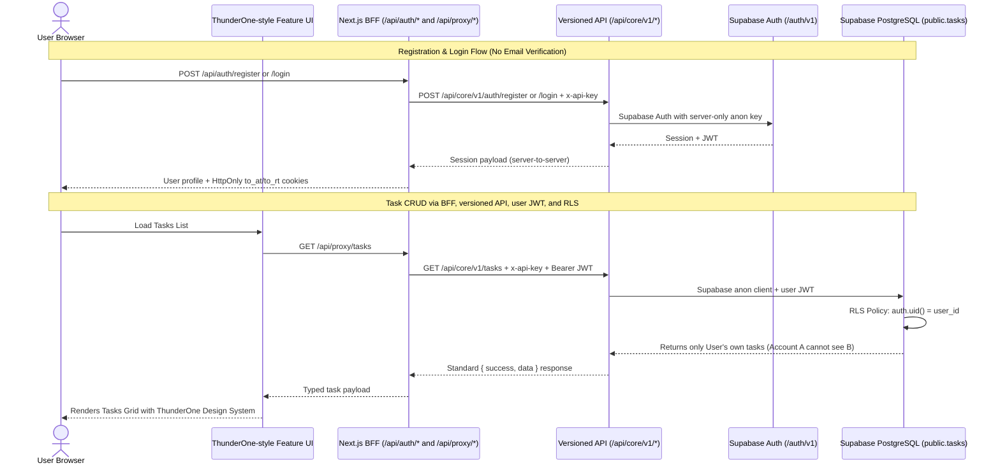

# Project Specification: Mini Project — My Work List (`spec.md`)

**Target Directory:** `D:\Programming\ThunderOne\my-work-list`
**Design System Reference:** `https://github.com/rdThunderThailand/-thunder-design-system` / [[07 - ThunderOne Design System (thunderone-ui)]] (`t1-tailwind-v4.css`, `DS-01` to `DS-14`)
**Architecture Standards:** ThunderOne-style Next.js frontend and BFF + Thunder_Core-style `/api/core/v1*` handlers + Supabase Auth/user-scoped anon SDK + PostgreSQL Row Level Security (RLS) + Vercel Deployment
**Company Assignment Reference:** Ticket #3 / #4: "Mini Project — My Work List" (Due Date: October 23, 2026)

**Environment Configuration:** Browser API base is `NEXT_PUBLIC_API_BASE_URL=/api/proxy`. Server-only settings are `CORE_API_URL`, `CORE_API_KEY`, `SUPABASE_URL`, and `SUPABASE_ANON_KEY`. No service-role key is used.

---

## 1. Problem Statement & Assignment Goal

The goal of this assignment is to develop and deploy an authentic, production-grade personal task management web application (**"My Work List"**) to test the developer's mastery of:
1. **Next.js (App Router)** & State/Session Management.
2. **ThunderOne and Thunder_Core architecture**: feature-first frontend, BFF transport, versioned API handlers, Supabase authentication, and PostgreSQL RLS without exposing server credentials.
3. **ThunderOne Design System (`thunderone-ui`)** following semantic tokens, platform styling, and accessible async states.
4. **Vercel Cloud Deployment** with clean environment variable isolation and reproducible verification criteria.

---

## 2. In-Scope vs. Out-of-Scope (Boundaries)

### ✅ In-Scope (Strict Mandatory Criteria AC-01 to AC-12)
1. **Auth & Session Management**:
   - Register with email/password without email verification (AC-01).
   - Login & Logout with proper session clearing (AC-02).
   - Session persistence on browser refresh and opening in new tabs (AC-03).
   - Unauthenticated users cannot view or manipulate any task data (AC-07).
2. **Task CRUD & Lifecycle Operations**:
   - Create, read, edit details, and delete tasks.
   - Non-empty name validation (client + database constraint).
   - Optional details field.
   - Exact status values: `Todo`, `Doing`, `Done` with state transition controls (AC-04).
   - Confirmation dialog before deletion (destruction barrier).
3. **Database Security & Multi-Account Isolation**:
   - PostgreSQL table `public.tasks` with strict Row Level Security (RLS) enabled.
   - RLS policies ensuring Account A cannot read, edit, delete, or reassign Account B's tasks (AC-06).
   - API data requests use the Supabase anon key with the authenticated user's JWT so PostgreSQL RLS remains active.
   - No `service_role` secret keys in the application or deployment environment.
4. **ThunderOne Design System & UX**:
   - `t1-tailwind-v4.css`, Manrope Google Font, and semantic `--t1-*` tokens (`DS-01` to `DS-14`).
   - DS-11 mandatory async states: **Loading**, **Empty State**, and **Error State with retry**.
   - Input focus rings, accessible keyboard navigation, and meaningful icon names.
5. **Deployment & Deliverables**:
   - Dedicated GitHub repository with versioned lockfile.
   - Deployment on Vercel connected to practice Supabase project (AC-12).
   - Clean `README.md`, `.env.example`, and reproducible `schema.sql` migration scripts.
   - Verification evidence and Handoff brief following company standards.

### ❌ Out-of-Scope (Explicitly Excluded by Brief §2)
- Password reset / "Forgot Password" flows.
- OAuth / Social login (Google, GitHub).
- Team sharing or multi-user task delegation across tenants.
- Realtime WebSocket subscriptions.
- File attachments / storage uploads.

---

## 3. Core Architecture & Security Flow

The project uses the architecture boundaries from `thunder_one_prj` and `Thunder_Core`:

- Frontend features call the shared transport in `src/lib/api/`.
- Client API requests go to the Next.js BFF at `/api/proxy/[...path]`.
- The BFF adds the server-only Core API key and the user's access token from the HttpOnly `to_at` cookie, then forwards to `/api/core/v1/*`.
- `/api/auth/*` owns login, registration, session refresh, and logout cookie lifecycle.
- Versioned Core handlers validate the app key and user JWT, then use `@supabase/supabase-js` with the anon key plus that user's JWT. Task queries remain subject to PostgreSQL RLS.

For this assignment, the runnable task API is implemented in this repository under `src/app/api/core/v1/`, using Thunder_Core's route, auth, error, and response-envelope conventions. `CORE_API_URL` points to this deployment by default. It can point to a separate compatible Core deployment later; the current Thunder_Core repository has no My Work List task endpoint.



---

## 4. Data Model & RLS Security Specification

### PostgreSQL Table: `public.tasks`
```sql
CREATE TABLE IF NOT EXISTS public.tasks (
    id uuid PRIMARY KEY DEFAULT gen_random_uuid(),
    user_id uuid NOT NULL DEFAULT auth.uid() REFERENCES auth.users(id) ON DELETE CASCADE,
    title text NOT NULL CHECK (btrim(title) <> ''),
    details text DEFAULT '',
    status text NOT NULL DEFAULT 'Todo' CHECK (status IN ('Todo', 'Doing', 'Done')),
    created_at timestamptz NOT NULL DEFAULT now(),
    updated_at timestamptz NOT NULL DEFAULT now()
);

-- Enable RLS
ALTER TABLE public.tasks ENABLE ROW LEVEL SECURITY;

-- Policy 1: SELECT (Only owner can read)
CREATE POLICY "Users can view their own tasks"
ON public.tasks FOR SELECT
TO authenticated
USING (auth.uid() = user_id);

-- Policy 2: INSERT (Only owner can create for self)
CREATE POLICY "Users can insert their own tasks"
ON public.tasks FOR INSERT
TO authenticated
WITH CHECK (auth.uid() = user_id);

-- Policy 3: UPDATE (Only owner can update self tasks and cannot transfer owner)
CREATE POLICY "Users can update their own tasks"
ON public.tasks FOR UPDATE
TO authenticated
USING (auth.uid() = user_id)
WITH CHECK (auth.uid() = user_id);

-- Policy 4: DELETE (Only owner can delete)
CREATE POLICY "Users can delete their own tasks"
ON public.tasks FOR DELETE
TO authenticated
USING (auth.uid() = user_id);
```

---

## 5. Project Directory Structure (`D:\Programming\ThunderOne\my-work-list`)

```text
my-work-list/
├── docs/
│   ├── HANDOFF.md                   # Formal assignment handoff document
│   └── AC_VERIFICATION.md           # Evidence checklist for AC-01 to AC-12
├── supabase/
│   ├── migrations/
│   │   └── 001_create_tasks.sql     # Schema + Constraints + RLS Policies + Comments
│   └── rollback/
│       └── 001_create_tasks.rollback.sql
├── src/
│   ├── components/
│   │   ├── layout/
│   │   │   └── Header.tsx           # ThunderOne 69px header with User pill & Logout
│   │   └── ui/
│   │       ├── StatusBadge.tsx      # DS-04 Status Pill for Todo, Doing, Done
│   │       ├── DeleteConfirmModal.tsx # Confirmation barrier before task deletion
│   │       └── Toast.tsx            # Semantic notifications
│   ├── config/
│   │   ├── env.ts                   # Browser-safe API base URL
│   │   └── server-env.ts            # Server-only Core/Supabase anon settings
│   ├── design-system/
│   │   └── t1-tailwind-v4.css       # Vendored ThunderOne tokens and Manrope font
│   ├── features/                    # Feature-first UI, hooks, and API services
│   ├── lib/
│   │   ├── api/                     # Axios client and requestApi wrapper
│   │   ├── api-utils.ts             # Core API auth, response, and error helpers
│   │   └── core-api.ts              # Server-to-server Core API client
│   ├── utils/supabase/server.ts     # Server anon/user-JWT clients
│   └── app/
│       ├── api/auth/                # BFF auth and HttpOnly cookie lifecycle
│       ├── api/proxy/[...path]/     # BFF feature API proxy
│       ├── api/core/v1/             # Versioned authenticated API handlers
│       ├── layout.tsx
│       ├── globals.css
│       └── page.tsx
├── .env.example                     # Clean template without secrets
├── package.json
├── tsconfig.json
└── README.md                        # Setup, RLS docs, and Vercel deployment guide
```

---

## 6. Phased Implementation Plan

- **Phase 1: Project Scaffolding & Design System Wiring**
  - Scaffold `my-work-list` with Next.js App Router, Tailwind v4, `@ant-design/icons`, `@supabase/supabase-js`.
- Add Axios for the shared frontend transport and Zod for API input validation.
  - Vendor `t1-tailwind-v4.css`, configure `Manrope` typography and `.env.example`.
- **Phase 2: Database Schema & Strict RLS Migration**
  - Create `001_create_tasks.sql` with table constraints and 4 atomic RLS policies.
  - Deploy to practice Supabase project and verify RLS isolation with 2 test accounts (Account A vs Account B).
- **Phase 3: Supabase Authentication Flow (Register, Login, Session)**
  - Implement email/password auth through `/api/auth/*` BFF routes and `/api/core/v1/auth/*` handlers.
  - Store access and refresh tokens in HttpOnly cookies; preserve sessions across refresh and tabs without exposing tokens to browser JavaScript.
- **Phase 4: Task CRUD & ThunderOne UI Implementation**
  - Implement `TaskBoard.tsx`, `TaskFormModal.tsx`, and `DeleteConfirmModal.tsx`.
  - Implement DS-11 states (Loading skeletons, empty state, error retry).
  - Add status transitions (`Todo` $\rightarrow$ `Doing` $\rightarrow$ `Done`).
- **Phase 5: Vercel Deployment, Verification & Handoff Delivery**
  - Push repository to personal GitHub.
  - Deploy to Vercel, configure production environment variables.
  - Execute AC-01 through AC-12 live tests on the deployed production URL and produce `HANDOFF.md`.

---

## 7. Acceptance Criteria Mapping (Verification Protocol)

| Criterion ID | Requirement | Verification Method |
| :--- | :--- | :--- |
| **AC-01** | Register without email confirmation | Create new account `user_test_1@example.com`; instant login without email. |
| **AC-02** | Login & Logout | Login, view tasks, click Logout, verify redirection and session teardown. |
| **AC-03** | Session Persistence | Hard refresh (`Ctrl + F5`) and open new tab; verify session remains intact. |
| **AC-04** | CRUD & Status Transitions | Create, update title/details, cycle `Todo` $\rightarrow$ `Doing` $\rightarrow$ `Done`, delete task. |
| **AC-05** | Data Persistence | Logout and log back in; verify all tasks persist in database. |
| **AC-06** | Database RLS Separation | Create task through Account A's authenticated API flow. Authenticate as Account B and verify B cannot read, edit, delete, or reassign A's task; confirm the API uses B's JWT and RLS remains enabled. |
| **AC-07** | Unauthenticated Blocking | Call `/api/proxy/tasks` without an auth cookie and call `/api/core/v1/tasks` without a bearer JWT; verify requests are rejected and no task data is returned. |
| **AC-08** | Validation & Async States | Test blank titles, empty list state, loading skeletons, and network retry. |
| **AC-09** | Design System Adherence | Verify Manrope typography, `--t1-*` tokens, 12px gaps, and keyboard accessibility. |
| **AC-10** | Clear README Setup | Reviewer can clone repo and run with their own Supabase keys following README. |
| **AC-11** | Engineering Explanations | Clear documentation of feature → transport → BFF → `/api/core/v1*` → user-JWT anon SDK → DB RLS architecture. |
| **AC-12** | Production Vercel Delivery | Verify live deployed URL passes all tests on actual cloud deployment. |
